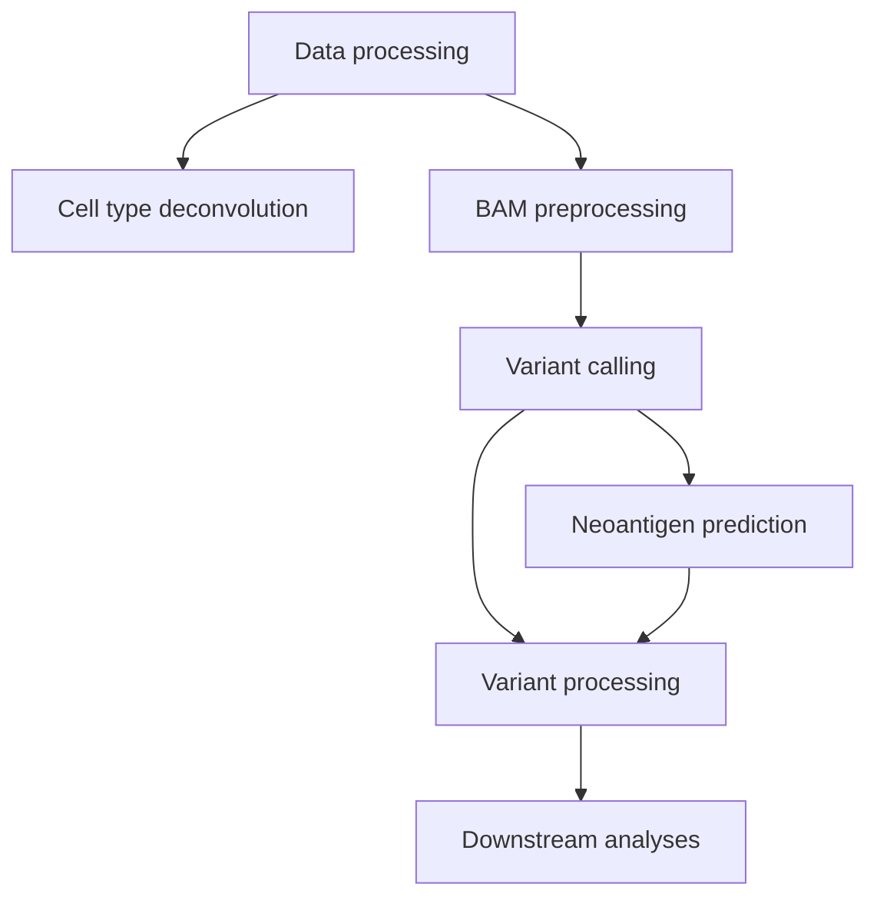

# CRMY-Spatial
Repository for the code used in **"Spatial patterns of APOBEC mutagenesis in the tumour microenvironment of Asian breast cancer"**. 
Manuscript status: in preparation ([preprint](https://doi.org/10.64898/2026.01.01.697328))

## About
These codes integrate Stereo-seq spatial transcriptomics gene expression data with existing workflows from [GATK](https://github.com/broadinstitute/gatk) to conduct variant calling, as well as the [pVACtools](https://pvactools.readthedocs.io/en/latest/) suite to conduct neoantigen prediction. This repo also includes codes for downstream processing and analyses of these data. The codes for data pre-processing and deconvolution of cell types are, too, included.

## Code structure
1. Raw Stereo-seq data processing
2. Cell type deconvolution using [RCTD](https://github.com/dmcable/spacexr)
3. BAM processing for VC workflow
4. Variant calling
5. Neoantigen prediction
6. Variant processing 

## Contact information
For further information, please contact ziching.tan@cancerresearch.my or jiawern.pan@cancerresearch.my
