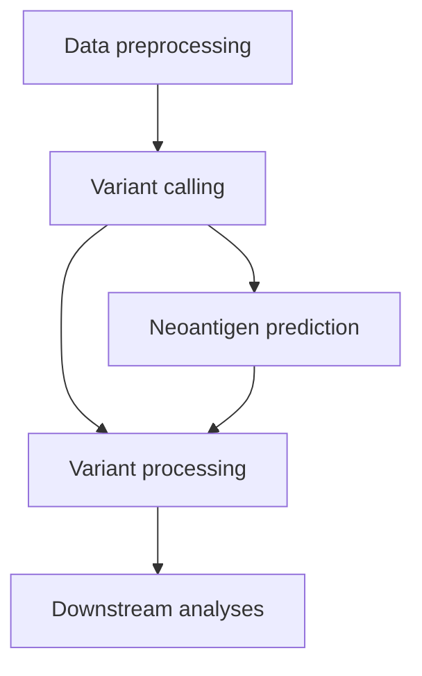

# CRMY-Spatial
Repository for the code used in **"Spatial patterns of APOBEC mutagenesis in the tumour microenvironment of Asian breast cancer"**.
Manuscript status: in preparation ([preprint](https://doi.org/10.64898/2026.01.01.697328))

## About
These codes integrate Stereo-seq spatial transcriptomics gene expression data with existing workflows from GATK to conduct variant calling, as well as the pVACtools suite to conduct neoantigen prediction. This repo also includes codes for downstream processing and analyses of these data.

## Code structure

## Contact information
For further information, please contact ziching.tan@cancerresearch.my or jiawern.pan@cancerresearch.my
